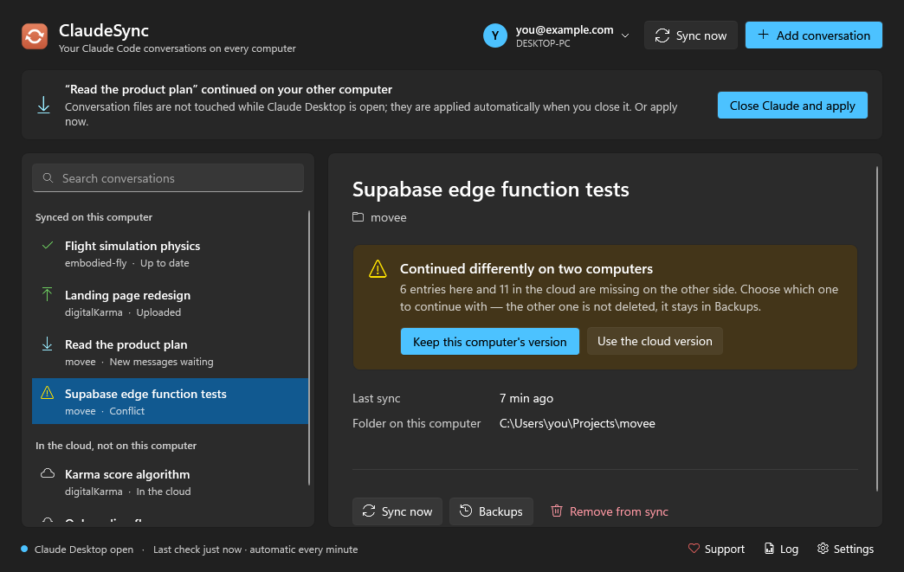
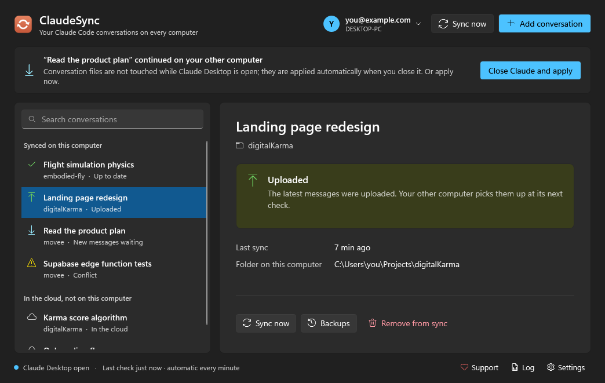
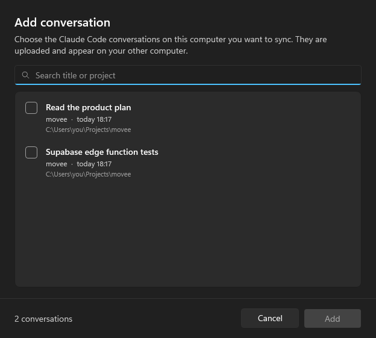

<div align="center">


# ClaudeSync

**Continue your Claude Desktop Code conversations on another computer — exactly where you left off.**

[Download](https://github.com/yigithanyorgancilar/claudesync/releases/latest) ·
[Server setup](docs/self-hosting.md) ·
[Türkçe](README.tr.md)

[](https://buymeacoffee.com/yigithanyorgancilar)




</div>

## Why

A local session in Claude Desktop's **Code** tab lives on the computer where it started. You can steer it from your
laptop with Remote Control, but it keeps running on the first machine — so that machine has to stay on, and Claude
keeps using *its* files and tools. Syncing `~/.claude` with a generic tool doesn't help either: Claude Desktop lists
conversations from its own per-machine records, so copied transcripts never show up in the sidebar.

ClaudeSync moves the whole conversation — the Claude Code transcript **and** Claude Desktop's record of it — so it
appears in the other computer's sidebar and continues **there**, locally, and you can just keep typing.

### Isn't this built into Claude Desktop?

Partly, and it's worth knowing the built-in options — you may not need ClaudeSync at all:

| | Remote Control | Cloud sessions | ClaudeSync |
| --- | --- | --- | --- |
| Where the session runs | on the first computer | on Anthropic's cloud | on the computer you're using |
| Works while the first computer is off | ❌ | ✅ | ✅ |
| Local files, tools, MCP servers | the first computer's | ❌ your GitHub repo | ✅ this computer's |
| Uncommitted changes, local databases | the first computer's | ❌ | ✅ (sync the folder with [Syncthing](#keep-your-project-files-in-sync-too--use-syncthing)) |
| Full conversation history | ✅ | a summary when you move a local session | ✅ |
| Setup | none | none | your own free server (~15 min) |

- **[Remote Control](https://code.claude.com/docs/en/remote-control)** (the *Other* section in the sidebar) is perfect when
  your desktop stays on and you just want to check in or steer from the couch or your phone.
- **[Cloud sessions](https://code.claude.com/docs/en/claude-code-on-the-web)** are great when the work lives in a GitHub
  repo and doesn't need your local environment.
- **ClaudeSync** is for the remaining case: you work locally and want the *same* session to continue on your other
  computer with that computer's files and tools — even when the first one is switched off.

ClaudeSync is a free hobby project, not a product. If Anthropic ships this natively, great — we'll point you to it.

## Features

- **Pick what to sync.** Only the conversations you add are uploaded, nothing else.
- **Two-way, automatic.** Checks every minute. New messages go up once the conversation has been quiet for 30 seconds;
  new messages from your other computer are applied when Claude Desktop is closed (or with one click on
  *Close Claude and apply*, which closes and reopens it for you).
- **Understands how Claude writes conversations.** Merely opening a conversation, rewinding it or editing a message
  changes the files in ways that naive file sync gets wrong (the classic result: the stale copy overwrites the new one).
  ClaudeSync compares the actual message ids instead, and follows a conversation across rewinds.
- **Never silently overwrites.** If a conversation continued differently on both computers you choose which one to
  keep; the other one stays available. Every local change is backed up first, and every cloud version is kept —
  restore any of them from **Backups**.
- **Different folders are fine.** `C:\Users\me\code\app` on one machine and `D:\work\app` on the other both work.
- **Remove from sync** everywhere with one click; the conversation itself stays on each computer.
- **Your data, your server.** Runs on your own free Supabase + Cloudflare account ([setup guide](docs/self-hosting.md)).
- English and Turkish interface, tray app, starts with Windows.

<table>
<tr>
<td></td>
<td></td>
</tr>
</table>

## Getting started

1. **Set up your server once** — about 15 minutes, free tiers only: [docs/self-hosting.md](docs/self-hosting.md).
2. **Download** `ClaudeSync.exe` from [Releases](https://github.com/yigithanyorgancilar/claudesync/releases/latest)
   and put it in a permanent folder.
   - `ClaudeSync.exe` (~0.5 MB) needs the [.NET 10 Desktop Runtime](https://dotnet.microsoft.com/download/dotnet/10.0) (x64).
   - `ClaudeSync-portable.exe` is larger but needs nothing else.
3. Start it, enter your three server values, sign in with Google, **Add conversation**.
4. On your other computer: same app, paste the **connection code** from *Settings* on the first computer, sign in
   with the same Google account, select the conversation and click **Get on this computer**.

Turn on **Settings → Start with Windows** so messages from your other computer are already applied before you open
Claude Desktop.

### Keep your project files in sync too — use Syncthing

ClaudeSync moves **conversations, not your code.** When you continue a conversation on the other computer, Claude
works on that computer's copy of the project; if it's older than the one the conversation was about, Claude will be
confused (or redo work). Keep the project folders themselves in sync as well. We recommend
**[Syncthing](https://syncthing.net)** — free, open source, peer-to-peer, no cloud in between:

1. Install Syncthing on both computers and pair them.
2. Share each project folder (the one you pick in ClaudeSync) between the two computers.
3. Add build output to Syncthing's ignore patterns so it doesn't copy thousands of generated files, e.g.
   `node_modules`, `bin`, `obj`, `.venv`, `dist`, `build`.

Git works too if you commit and pull every time you switch — Syncthing just does it without you having to remember.
Don't put `~/.claude` or Claude Desktop's data folder in Syncthing; that's ClaudeSync's job, and syncing those files
while Claude is running can corrupt them.

## How it works

```
Computer A                        your cloud                        Computer B
~/.claude/projects/…/<id>.jsonl   Supabase: projects, versions      same files, moved to B's
Claude Desktop session record  ─▶ R2: zip per version           ─▶  project folder and account
```

- A conversation is identified by its Claude Desktop id, which survives rewinds. All of its transcripts travel together.
- Sync decisions compare **sets of message ids**, not bytes: if the cloud has not changed since the last sync, this
  computer's state is uploaded as is; if only the cloud changed, it is applied; if both gained different messages,
  you get a conflict to resolve.
- Uploads use compare-and-swap on the server, so two computers can never silently replace each other's version.
- Conversation files are only written while Claude Desktop is closed and the conversation isn't open in a terminal.

## Limitations

- **Windows only**, Claude Desktop's Code tab (Claude Code CLI conversations in `~/.claude/projects` are what it moves).
- It syncs conversations only — sync the project files themselves with [Syncthing](#keep-your-project-files-in-sync-too--use-syncthing) or git.
- **Unofficial.** It relies on Claude Desktop's undocumented local files; a Claude update may require a ClaudeSync
  update. Not affiliated with or endorsed by Anthropic.
- Conversations are stored in your own R2 bucket **without end-to-end encryption**.
- Each conversation package is limited to 100 MB.

## Related

[claude-sync](https://github.com/tawanorg/claude-sync) syncs the whole `~/.claude` folder (settings, skills, CLI
sessions) with end-to-end encryption to any S3-compatible storage — great for the Claude Code CLI. ClaudeSync focuses
on one thing it doesn't do: making **Claude Desktop** conversations continue on another machine.

## Building

```powershell
dotnet build -c Release
dotnet run -c Release --project tests/EngineTests
dotnet publish ClaudeSync.csproj -c Release -r win-x64 --self-contained false -p:PublishSingleFile=true -o publish
```

`ClaudeSync.exe --demo` opens the UI with sample data (no network). The sync engine lives in `Core/`, the WPF UI
(Windows 11 Fluent theme) in `UI/`, the server in `server/`. The engine tests simulate two computers against an
in-memory cloud, including rewinds, conflicts and removal.

Issues and pull requests are welcome.

## Support

ClaudeSync is free. If it saves you time, you can [buy me a coffee](https://buymeacoffee.com/yigithanyorgancilar) ☕

## License

[MIT](LICENSE)
