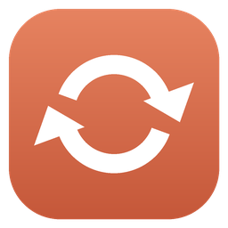

# ClaudeSync

**Claude Desktop'taki Code sohbetlerine başka bir bilgisayarda, kaldığın yerden devam et.**

[İndir](https://github.com/yigithanyorgancilar/claudesync/releases/latest) ·
[Sunucu kurulumu](docs/self-hosting.md) ·
[English](README.md)

## Neden

Claude Desktop, **Code** sekmesindeki her sohbeti başladığı bilgisayarda tutar. Masaüstünde uzun bir oturuma başlayıp
laptopa geçince sohbet orada yoktur. `~/.claude` klasörünü herhangi bir araçla eşitlemek de yetmez: Claude Desktop
sohbet listesini her bilgisayarda kendi kayıtlarından okur, kopyalanan transcript'ler kenar çubuğunda görünmez.

ClaudeSync sohbetin tamamını — Claude Code transcript'ini **ve** Claude Desktop'ın kaydını — taşır; sohbet diğer
bilgisayarın kenar çubuğunda görünür ve yazmaya devam edersin.

## Özellikler

- Sadece seçtiğin sohbetler eşitlenir.
- Her dakika otomatik kontrol; sohbet 30 saniye sessiz kalınca yüklenir, diğer bilgisayardan gelenler Claude Desktop
  kapalıyken uygulanır (ya da tek tıkla *Claude'u kapat ve uygula*).
- Sohbeti açmak, geri almak (rewind) veya mesaj düzenlemek dosyaları değiştirir; ClaudeSync bayt yerine mesaj
  kimliklerini karşılaştırır, eski kopyanın yenisini ezmesine izin vermez.
- İki bilgisayarda farklı devam edilmişse hangisini tutacağını sen seçersin; diğeri kaybolmaz. Her yerel değişiklikten
  önce yedek alınır, bulutta tüm sürümler saklanır.
- Farklı klasör yolları sorun değil.
- Tek tıkla bütün bilgisayarlarda eşitlemeden kaldırma.
- Veri kendi ücretsiz Supabase + Cloudflare hesabında durur ([kurulum rehberi](docs/self-hosting.md), İngilizce).
- Türkçe ve İngilizce arayüz, tepsi uygulaması, Windows ile başlama.

## Başlarken

1. Sunucunu bir kez kur (yaklaşık 15 dakika, ücretsiz): [docs/self-hosting.md](docs/self-hosting.md).
2. [Releases](https://github.com/yigithanyorgancilar/claudesync/releases/latest) sayfasından `ClaudeSync.exe`'yi indir
   ([.NET 10 Desktop Runtime](https://dotnet.microsoft.com/download/dotnet/10.0) gerekir) ya da runtime istemeyen
   `ClaudeSync-portable.exe`'yi kullan.
3. Aç, üç sunucu değerini gir, Google ile giriş yap, **Sohbet ekle**.
4. Diğer bilgisayarda ilk bilgisayarın *Ayarlar → Bağlantı kodunu kopyala* ile aldığın kodu yapıştır, aynı hesapla
   giriş yap, sohbeti seçip **Bu cihaza al**.

### Proje dosyalarını da eşitle — Syncthing öneriyoruz

ClaudeSync **sohbetleri taşır, kodunu değil.** Sohbete diğer bilgisayarda devam edince Claude o bilgisayardaki proje
kopyası üzerinde çalışır; o kopya sohbetin konuştuğu halden eskiyse Claude şaşırır ya da aynı işi yeniden yapar. Bu
yüzden proje klasörlerini de eşitle. Önerimiz **[Syncthing](https://syncthing.net)**: ücretsiz, açık kaynak, arada
bulut olmadan doğrudan bilgisayardan bilgisayara.

1. Syncthing'i iki bilgisayara kur ve eşleştir.
2. ClaudeSync'te seçtiğin her proje klasörünü iki bilgisayar arasında paylaş.
3. Binlerce üretilmiş dosya kopyalanmasın diye derleme çıktılarını Syncthing'in yok sayma listesine ekle:
   `node_modules`, `bin`, `obj`, `.venv`, `dist`, `build` gibi.

Her geçişte commit/pull yapıyorsan git de olur; Syncthing bunu hatırlamana gerek bırakmadan yapar. `~/.claude` ya da
Claude Desktop'ın veri klasörünü Syncthing'e koyma: onları ClaudeSync taşır, Claude açıkken eşitlemek dosyaları bozabilir.

## Sınırlar

- Yalnızca Windows ve Claude Desktop'ın Code sekmesi.
- Sadece sohbetleri eşitler; proje dosyaları için Syncthing ya da git kullan.
- Resmi değildir; Claude Desktop'ın belgelenmemiş dosyalarını okur, Claude güncellemeleri ClaudeSync güncellemesi
  gerektirebilir. Anthropic ile bağlantısı yoktur.
- Sohbetler kendi R2 alanında uçtan uca şifrelenmeden durur.

## Destek

ClaudeSync ücretsiz. İşine yaradıysa [bir kahve ısmarlayabilirsin](https://buymeacoffee.com/yigithanyorgancilar) ☕

## Lisans

[MIT](LICENSE)
